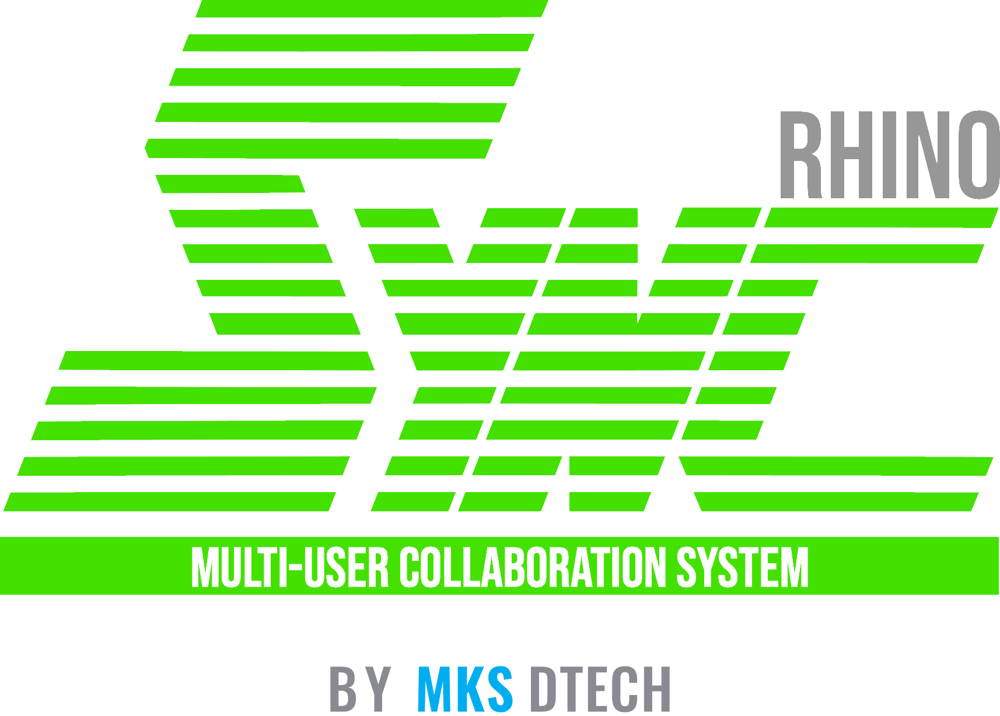

  

# Rhino Sync

Rhino Sync enables multi-user collaboration for Rhino. Teams lock, reload and synchronize Rhino objects around a shared central model, using a network disk, Google Drive, OneDrive, Dropbox or Egnyte as the collaboration layer.

[mksdtech.com/products/rhino-sync](https://mksdtech.com/products/rhino-sync)
